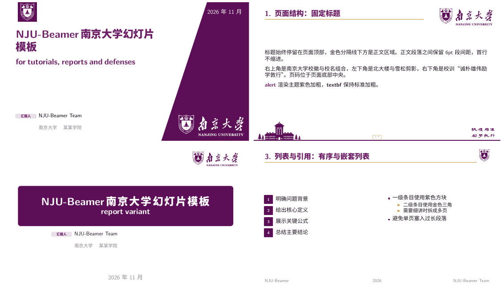
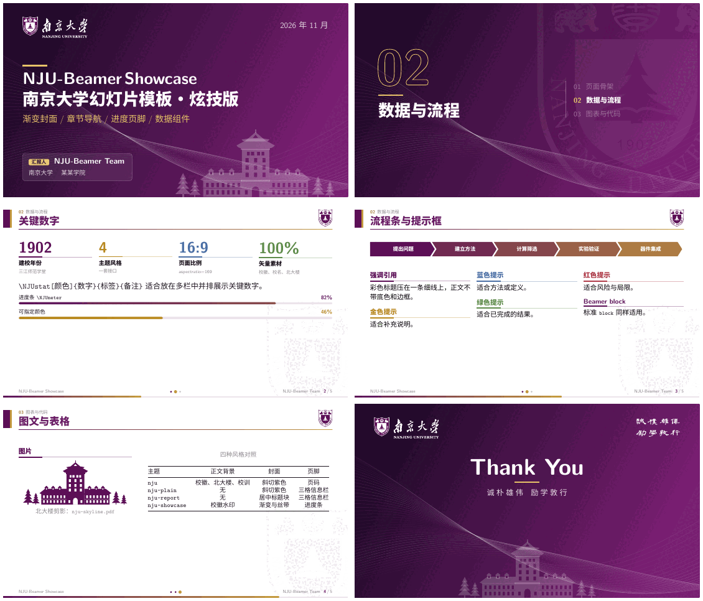

# NJU-Beamer

NJU-Beamer 是一套南京大学风格的 LaTeX Beamer 主题、模板和完整示例仓库，适合课程讲义、组会汇报、开题与中期答辩。版式体系沿用 [VSP-Beamer](https://github.com/Heaticy/vsp-beamer)：`make + latexmk + XeLaTeX` 构建、16:9 页面、统一的章节页、标题层级、紧凑页脚与提示框接口；配色换为南大紫（`#5C0F56`，CMYK 50/100/0/40）与金色点缀。





成品 PDF 见 [Releases](https://github.com/Heaticy/NJU-beamer/releases)。

## 主题

| 主题 | 正文背景 | 封面 | 页脚 |
| --- | --- | --- | --- |
| `nju` | 北大楼剪影、校训 | 斜切紫色块 + 校名 | 页码 |
| `nju-plain` | 无 | 斜切紫色块 + 校名 | 三格信息栏 |
| `nju-report` | 无 | 居中紫色标题块 | 三格信息栏 |
| `nju-showcase` | 校徽水印 | 渐变封面 + 彩带 | 进度条 + 页码 |

四个主题共用 `themes/beamerthemeNJUBase.sty`，接口完全相同，文稿只改一行 `\usetheme{...}` 即可切换风格。

## 支持范围与依赖

仅维护 Linux，Ubuntu/Debian 为验证基线。

- GNU Make、TeX Live 2022+（XeLaTeX、Beamer、CTeX、TikZ、tcolorbox、tabularray、`latexmk`）
- 西文 Latin Modern，中文系统字体 Noto CJK SC
- 重新生成素材时需要 `njuvisual`（TeX Live 自带）和 `pdfseparate`

```bash
sudo apt install make latexmk texlive-xetex texlive-lang-chinese texlive-latex-extra \
  fonts-noto-cjk mupdf-tools poppler-utils imagemagick jq
```

## 使用

```bash
make                     # 构建全部模板和 practice 到 build/
make check               # 严格检查：溢出、缺字、字体与宏包警告 + PDF 视觉审计
make render INPUT=templates/nju.tex OUTPUT=/tmp/nju.pdf
make list                # 列出参与构建的文稿
make assets              # 由 assets-src/nju-assets.tex 重新生成 shared-assets/
make clean
```

最小文稿：

```latex
\documentclass[aspectratio=169,10pt]{beamer}
\usepackage[UTF8,fontset=none]{ctex}
\usetheme{nju}            % nju / nju-plain / nju-report / nju-showcase

\title{报告标题}
\subtitle{副标题}
\NJUsetspeaker[汇报人]{姓名}{南京大学 \quad 某某学院}
\NJUsetupfootline{课程或会议}{2026}{姓名}
\date{2026年11月}

\begin{document}
\NJUtitleframe
\section{第一部分}
\begin{frame}{页面标题}
  正文。
\end{frame}
\NJUendframe[谢谢！]{敬请批评指正}
\end{document}
```

通过仓库 Makefile 构建时会自动设置 `TEXINPUTS`，文稿中不需要写主题或素材的绝对路径。

## 接口

| 接口 | 作用 |
| --- | --- |
| `\NJUtitleframe` / `\NJUendframe[标题]{副标题}` | 封面页 / 结束页 |
| `\NJUsectionframe{标题}{副标题}` | 手动章节页（`\section` 自动生成章节页） |
| `\NJUsetspeaker[标签]{姓名}{单位}` | 封面汇报人信息 |
| `\NJUsetupfootline{左}{中}{右}` | 页脚三格信息 |
| `njuquote` / `njuquoteblue` / `njuquotered` / `njuquotegreen` / `njuquotegold` / `njuquoteblack` | 提示框：彩色标题压在细线上，正文无底色、无边框 |
| `block` / `alertblock` / `exampleblock` | 标准 Beamer 块，与提示框同一画法 |
| `\NJUstat[颜色]{数字}{标签}{备注}` | 关键数字 |
| `\NJUmark{文字}` / `\NJUchip[颜色]{文字}` | 荧光笔高亮 / 胶囊标签 |
| `\NJUsteps{a,b,c}` / `\NJUmeter[颜色]{比例}{标签}{数值}` | 箭头流程条 / 进度条 |
| `\alert{...}` | 主题色加粗；`\textbf` 保持标准加粗 |
| `\code{...}`、`Code`、`Figure`、`Table` | 行内代码、代码块、带小标题的图表 |

## 目录

```text
themes/          共享主题 beamerthemeNJUBase.sty 与 4 个主题入口
templates/       4 份完整、可直接编辑的模板
practice/        内容型示例：Midterm-Defense-LiAnode（硕士中期答辩，nju 与 nju-showcase 两版）
shared-assets/   运行时矢量素材（校徽、校名、校训、北大楼、背景）
assets-src/      素材源文件 nju-assets.tex
scripts/         素材生成、发布检查、PDF 视觉审计
```

## License

源代码与原创文档使用 [MIT License](LICENSE)。南京大学名称、校徽、校名书法、校训与建筑形象不由 MIT 重新授权，边界见 [THIRD_PARTY_ASSETS.md](THIRD_PARTY_ASSETS.md)。
